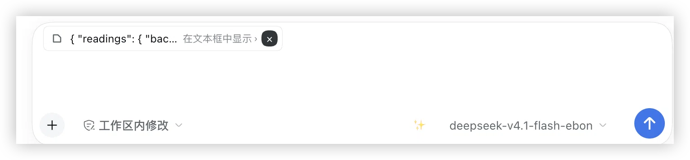
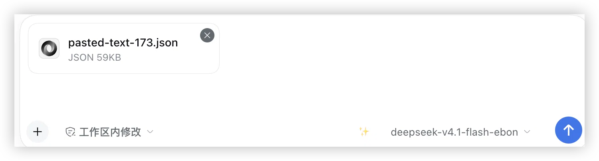

# dsh-paste-spill

English | [中文](README.zh.md)

Inbound large-paste handling for the DeepSeek Harness composer: a **4–50 KB** paste folds into **one chip per paste** (expand or delete it on its own), and a **≥ 50 KB** paste becomes a **real file attachment** with a deliverable card in the turn tail.

`dsh-spill` covers the outbound direction — tool output leaving the model. This plugin covers the opposite half: a large log, diff, JSON dump or document pasted **into** the input box.

| Layer | Pasted size (UTF-8 bytes) | What happens |
|---|---|---|
| Fold | 4,000 – 50,000 | That pasted run leaves the editor and becomes one chip. One chip per paste — several coexist, and earlier chips are never overwritten. |
| Spill | ≥ 50,000 | The text is uploaded as a real attachment: the message carries a `file` block and the turn tail gets a clickable card that opens the file in the right sidebar. |
| Transcript | any ≥ 4,000-byte paragraph in a **sent** message | Draws as a collapsible card inside the bubble. Rendering only: the message, the prompt and the clipboard keep the original text. |

The two layers are independent and both measure the **pasted text**, not the draft: the fold layer changes what the composer looks like, the spill layer changes what the model receives. Pastes under the fold threshold are left entirely alone.

Both thresholds and the **Always paste as text** checkbox are **configurable**: Settings → Plugins → **Paste folding**. Values are stored in the plugin's own config (persisted into the active profile's cordis patch, so they survive restarts and can also be edited by hand), and a change applies to new pastes immediately — no reload, and chips already in the composer are unaffected. The transcript card follows the fold threshold, so a paste behaves the same before and after it is sent. The page refuses an attachment threshold that is not above the fold threshold rather than silently rewriting it.

## The fold layer (4,000 – 50,000 bytes)

Pasting 4 KB–50 KB in one go moves **just that pasted run** out of the editor and into a chip held by the plugin. Text you typed, and chips from earlier pastes, are untouched.

Each chip shows:

- the first 20 characters of its paste (whitespace flattened) as a preview line;
- `在文本框中显示 ›` / `Show in text box ›` — click to write **that chip's** full text back into its position and release it;
- `×` — delete **just that chip** and release its text (`删除这段文本` / `Delete this text`).

The chip is a real editor node rather than a decoration, and it registers an `inputTriggers` source whose `serialize(ref)` returns the **full original text**. Sending therefore posts the paste itself — not a placeholder, and not an attachment.

Because one paste equals one chip, pasting a second 6 KB block **appends** a chip instead of replacing the first one: a chip is the only carrier of its text, so overwriting one would silently delete that paste.

**The chip brings its own line break.** Stock appends a single space after a reference chip, which left the caret on the chip's own line — you had to press Enter before writing the question. The insert now puts the caret on the next line, and that newline travels with the message (`{…}` then `why does this throw?`), which is exactly what keeps the question out of the transcript card: the paste is a block, not a run-on after your sentence.

The floating chip band measures itself and publishes its height as `--dshps-chip-band` on the composer card, which the card turns into `padding-top`. The chips sit above the first line of input instead of covering it, and reflow when several chips wrap onto a second line.

## The spill layer (≥ 50,000 bytes)

A paste of 50,000 bytes or more is turned into a `File` and sent through the composer's existing attachment upload path, with a content-sniffed name (`pasted-text-<n>.json` / `.md` / `.py` / `.js` / `.html` / `.csv` / `.txt`). The result is a legal `file` block in the message, so the model receives a read-only host path through the stock attachment handling — no session format change and no model-side change.

### Always paste as text

The sniffing is a heuristic, and machine output defeats it: a macOS crash report was named `pasted-text-1.js` because its stack frames read `v8::Message::ErrorLevel() const`. With **Always paste as text** ticked on the settings page, every attachment is named `.txt` and the content sniffing is skipped entirely (the MIME type is already always `text/plain`; only the name changes).

- **Off by default** — for a pasted code fragment, sniffing is still the better default.
- Takes effect on the next paste, never retroactively: an attachment already in the composer keeps its name.
- Only the filename changes. Thresholds, chips, the transcript card, the upload path and post-send behaviour are untouched.

The host half watches `agent/inbox/inserted` for those paste files, resolves each one's host path from the attachment store, and publishes a `deliverables/presented` event on `agent/pre-step`, which the stock deliverables UI renders as a clickable card in the turn tail. Clicking the card opens the file in the right sidebar. The original text is then excised from the composer **in place** — the pasted run's own span is overwritten with `""`, never the whole draft, so other chips, typed text, the caret and undo history all survive.

## After sending (the transcript card)

The fold chip lives in the composer. Once the message is sent, the session holds plain text and stock draws it as one tall `pre-wrap` bubble — DSH has no long-message collapse of its own.

So any paragraph of at least **4,000 UTF-8 bytes** in a user message renders as a collapsible card: `Pasted text · 5.9 KB · 128 lines`, the first two lines as a preview, and `Show` / `Hide` / `Copy`. Expanding shows the full text in a scrolling `pre` capped at 320 px.

It is a **display layer only**, built on the conversation package's public user-text pipeline (`ctx.uiConversation.userText.register` + the `conversation.user.text.node` slot — the same machinery stock uses for its `@file` chips):

- the message text is never rewritten, so the model's prompt, the session log, export and the copy button all see the original bytes;
- the threshold is the fold layer's own configured threshold (4,000 by default), so a paste behaves the same before and after it is sent;
- surfaces that are not the live transcript (queue preview, submission echo, read-only views) pass `interactive: false` and keep their plain text;
- nothing is stamped into the message to mark it as a paste — a sentinel would leak into the prompt, the log and the clipboard, so detection is content-based;
- **the prompt stays a prompt**: instruction lines at the edges of the paragraph ("帮我看看这段代码有什么问题" above, "这段报错是什么原因？" below) are peeled out of the card, up to three per edge. The card wraps the data block, the sentence remains normal bubble text.

Peeling can only recognise data positively (long lines, indentation, code/log punctuation, brackets, timestamps), so a pasted 4 KB *document of prose* still collapses — minus a few edge lines. Expanding is always one click away.

## Screenshots

**The fold layer** — a 4–50 KB paste becomes one chip: preview line, `在文本框中显示 ›` to write it back, `×` to delete just that paste.



**The spill layer** — a ≥ 50 KB paste becomes a real attachment (`pasted-text-173.json`, 59 KB) in the composer, so the model gets a file instead of a wall of text.



dsh-market shows these on the plugin card and in the detail view; they are declared in [`screenshots.json`](screenshots.json) so their order and selection are curated here rather than guessed from this README.

## Install

From the DeepSeek Harness CLI, into the **web** profile — published on npm as [`@code_tin/dsh-paste-spill`](https://www.npmjs.com/package/@code_tin/dsh-paste-spill):

```sh
dsh plugin --profile web add @code_tin/dsh-paste-spill
```

Prefer the source? The same package installs straight from GitHub:

```sh
dsh plugin --profile web add github:winditer/dsh-paste-spill
```

On **DSH Desktop**, install it from the in-app plugin manager (Settings → Plugins) or through the plugin market; the CLI refuses `--profile desktop` because that profile is owned by the application.

Working on the plugin from a local checkout? `scripts/install-into-profile.sh` links this repository into the desktop profile and adds the dependency entry that keeps the bundle row from being erased by profile reconciliation.

After install, the browser half is a page-level module: **refresh the page** (or relaunch) to pick it up.

## Compatibility

- Declared in `package.json` as `engines.dsh: ">=0.1.7-rc.2 <0.3.0-0"`, so dsh-market can state the requirement on the plugin card. Verified on DSH **0.1.7-rc.2** and **0.2.0-rc.2** (web and desktop).
- Web UI only (`dsh.client.platform: "web"`): the fold chip, the chip band and the attachment upload all live in the browser half. The host half runs anywhere the bundle loader does.
- No stock package is patched or replaced. The plugin uses public extension points only: an `inputTriggers` source, the `conversation.input.overlay` slot, the existing attachment upload, and the `agent/inbox/inserted` / `agent/pre-step` session events.

## How it works

```
package @code_tin/dsh-paste-spill — one loader row, two halves
  browser half  lib/client.js     (dsh.client, platform: web)
    draft watcher + paste events
      4000-50000 → register a chip source, replace the pasted run with a chip node,
                   hold the text by ref, render the chip band in the composer overlay
      >= 50000   → synthesize a File and ride the stock attachment upload
  host half     lib/index.js      (exports["."], dsh.bundle.patch)
    agent/inbox/inserted → record the paste attachment's host path
    agent/pre-step       → session.append("deliverables/presented", ...)
                           → stock deliverables card → right-sidebar preview
```

One package, one row: `cordis.patch.yml` declares `@code_tin/dsh-paste-spill` once, and the loader imports the host half through `exports["."]` while the web-modules scanner discovers the browser half from `dsh.client` plus `exports["./client"]` in the same `package.json`.

The host half also exports a schemastery `Config` with the two thresholds marked `.volatile()`. That is the plugin's only settings surface: the settings domain reads a plugin entry's own schema, so declaring the fields is what puts a form (and this plugin's page) on screen. `volatile` means a write updates the running plugin instead of remounting it — which matters here, because a remount would drop the folds the composer is currently holding.

## Development

```sh
npm install            # one dev dependency: @deepseek-ai/schemastery, for the Config schema tests
node --test            # 136 tests: host half 21 (helpers 7 + plugin 10 + config 4), browser half 115
```

- The plugin package **is** the repository root, which is what the market's `dsh.bundle` check reads.
- [docs/internals.md](docs/internals.md) — the implementation log: the real-device bugs behind the current design, the adversarial review findings, and the debugging paths that were tried and rejected.
- [docs/superpowers/specs/](docs/superpowers/specs/) and [docs/superpowers/plans/](docs/superpowers/plans/) — design document and implementation plan.
- [fixtures/](fixtures/) — real paste payloads (3 KB / 6 KB / 60 KB) used by the tests.
- [scripts/read-leveldb.py](scripts/read-leveldb.py) and [scripts/read-session.mjs](scripts/read-session.mjs) — evidence tools for reading renderer Local Storage and what a session actually submitted, used when no console is available.
- In-app diagnostics are written to `localStorage["dsh.paste-spill.diag"]` (`bySession.<sessionId>` for the per-session facts). `build` must equal the current `BUILD_REV` and `applyRanAt` must be fresh if a new build is really loaded.
- Releasing: bump `version` in `package.json`, then `pnpm publish`. The `files` list keeps the tarball to `lib`, `cordis.patch.yml`, both READMEs, `screenshots.json`, `assets` and `LICENSE`; there is no build step, so a published version is exactly the source.

## Known limitations

- Chips are per session. Switching away while a paste is folded and coming back restores the original text into the input box (the plugin no longer draws a chip for it), so the text is never lost and the chip's label is never sent in its place.
- A chip insert is a revision CAS on the draft: when the revision moved, the insert is retried and, if it is still refused, the fold record is rolled back — the text stays in the input box and no chip is drawn for it.
- Spilled pastes are excised from the composer only when the pasted run can still be located. When it cannot, the text is left in place next to the attachment (harmless, and recoverable) rather than clearing the draft.
- If the attachment upload fails, the text is written back into the editor best-effort; the failed attachment card keeps its retry control.
- The chip label itself (`已折叠 5.9 KB`) is currently Chinese; the chip tooltip and the expand affordance are localized (zh / en).

## License

[MIT](LICENSE)