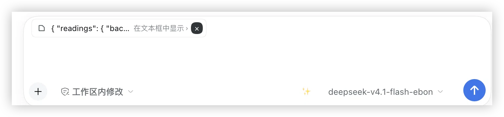
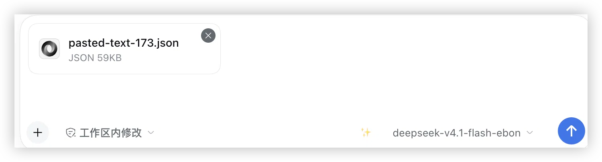

# dsh-paste-spill

[English](README.md) | 中文

DSH 输入框的**入站**大文本粘贴处理：**4–50 KB** 的粘贴折叠成一枚 chip（**每次粘贴一枚**，可单独展开或删除），**≥ 50 KB** 的粘贴转成**真附件**，并在 turn 末尾出一张可点开的交付卡。

`dsh-spill` 管的是出站方向（工具输出离开模型）。本插件补上相反的那一半：把一大段日志、diff、JSON 或文档**粘进**输入框时该怎么办。

| 层 | 粘贴大小（UTF-8 字节） | 行为 |
|---|---|---|
| 折叠层 | 4,000 – 50,000 | 刚粘贴的那一段移出编辑器，变成一枚 chip。每次粘贴一枚，多枚共存，先前的 chip 不会被覆盖 |
| 转文件层 | ≥ 50,000 | 文本作为真附件上传：消息里是 `file` 块，turn 末尾出现可点卡片，点击在右侧栏打开文件 |
| 展示层 | **已发送**消息里任意 ≥ 4,000 字节的段落 | 在气泡里渲染为可展开卡片。只是显示层：消息本身、模型收到的内容与剪贴板都仍是原文 |

两层相互独立，且都以**粘贴进来的那段文本**为基准（不是整篇草稿）：折叠层改的是输入框外观，转文件层改的是模型收到什么。小于折叠阈值的粘贴完全不做处理。

两个阈值和 **始终粘贴为文本** 勾选项**都可配置**：设置 → 插件 → **粘贴折叠**。值存在插件自己的配置里（持久化进当前 profile 的 cordis patch，重启不丢，也可以手改配置文件），改完对之后的粘贴立即生效——不用重载，输入框里已经折叠好的 chip 也不受影响。发送后的卡片跟折叠阈值走，所以同一段粘贴在发送前后行为一致。界面会拒绝"转文件阈值不高于折叠阈值"的组合，而不是偷偷改写它。

## 折叠层（4,000 – 50,000 字节）

一次粘进 4 KB–50 KB 时，**只有刚粘贴的那一段**移出编辑器，交给插件按 `ref` 持有的 chip。你自己打的字、以及之前粘贴留下的 chip 都不动。

每枚 chip 显示：

- 该段粘贴的前 20 个字符（空白折叠成一行）作为预览；
- `在文本框中显示 ›` / `Show in text box ›` —— 点击把**这一枚** chip 的原文写回它原来的位置并释放；
- `×` —— **只删除这一枚** chip 并释放它的文本（`删除这段文本` / `Delete this text`）。

chip 是编辑器里的真实节点，不是装饰：它注册了一个 `inputTriggers` source，`serialize(ref)` 返回**原文全文**。所以发送出去的就是这段粘贴本身——既不是占位符，也不是附件。

一次粘贴等于一枚 chip，因此第二次粘贴 6 KB 是**追加**一枚，而不是覆盖第一枚：chip 是它那段文本的唯一载体，覆盖就等于把那段粘贴删掉。

**chip 自带一个换行**：插入后光标已经在新的一行，直接写问题就行，不必先按 Enter（stock 原生只补一个空格）。这个换行也随消息发出去——`{…}\n这段报错是什么原因？`——所以对话里的卡片天然与你的问题分开：粘贴被当成一个**块**，而不是接在句子后面的文字。

浮动的 chip 带自己量自己的高度，作为 `--dshps-chip-band` 写到输入卡片上，卡片再把它变成 `padding-top`。chip 浮在第一行输入之上而不是盖住它；多枚 chip 换行时高度随之变化。

## 转文件层（≥ 50,000 字节）

50,000 字节及以上的粘贴会被合成一个 `File`，走输入框**既有的附件上传链路**，文件名按内容嗅探（`pasted-text-<n>.json` / `.md` / `.py` / `.js` / `.html` / `.csv` / `.txt`）。结果是消息里一个合法的 `file` 块，模型通过 stock 附件处理拿到只读宿主路径——不改 session 格式，也不改模型侧。

### 始终粘贴为文本

嗅探是启发式，遇到机器输出就会失手：一份 macOS 崩溃报告因为栈帧里写着 `v8::Message::ErrorLevel() const`，被命名成了 `pasted-text-1.js`。勾选设置页里的 **始终粘贴为文本** 后，扩展名一律是 `.txt`，完全跳过内容嗅探（附加类型仍是 `text/plain`，它本来就不随扩展名变）。

- 默认**不勾选**：对"粘贴一段代码"来说，嗅探仍是更好的默认。
- 保存后立即生效，只影响之后的粘贴；已经在输入框里的附件不会被改名。
- 只改文件名，不影响折叠阈值、chip、卡片、上传链路或发送后的行为。

宿主半监听 `agent/inbox/inserted` 找出这些粘贴文件，从附件存储解析出宿主路径，并在 `agent/pre-step` 里发布 `deliverables/presented` 事件；stock 的交付 UI 因此在 turn 末尾渲染一张可点卡片，点击在右侧栏打开文件。随后原文从输入框中**就地**清除——只把粘贴那一段自己的 span 写成 `""`，绝不重写整篇草稿，所以其它 chip、手打的文字、光标和 undo 历史都不受影响。

## 发送后（对话内卡片）

折叠层的 chip 只活在输入框里。消息一发出，session 里就是纯文本，stock 把它画成一个 `pre-wrap` 的高气泡——DSH 自己没有"长用户消息折叠"。

因此用户消息里**任意 ≥ 4,000 UTF-8 字节的段落**会渲染成一张可展开的卡片：`粘贴内容 · 5.9 KB · 128 行`，前两行预览，右侧 `展开` / `收起` / `复制`。展开后是卡内滚动的 `pre`（上限 320 px）。

这是**纯展示层**，走 conversation 包公开的 user-text 管线（`ctx.uiConversation.userText.register` + `conversation.user.text.node` 槽位——stock 的 `@文件引用` chip 用的就是这一套）：

- 消息文本从不改写，所以模型收到的 prompt、session log、导出与复制按钮拿到的都是原文；
- 阈值直接复用折叠层的**当前配置值**（默认 4,000），同一段粘贴在发送前后行为一致；
- 不是正式对话的位置（队列预览、提交回显、只读视图）拿到 `interactive: false`，保持纯文本外观；
- 不给消息盖任何"这是粘贴"的标记：标记会进 prompt、进日志、进剪贴板，所以判定只能基于内容本身；
- **你的 prompt 还是 prompt**：段落首尾的指令行（上面一句"帮我看看这段代码有什么问题"、下面一句"这段报错是什么原因？"）会被剥在卡外，每边最多三行——卡片只包数据块，句子留作气泡正文。

剥行只能"正面识别数据"（长行、缩进、代码/日志记号、括号、时间戳），所以**整段都是散文**的 4 KB 粘贴仍会被折叠（只是少了首尾几行）。展开永远只差一次点击。

## 截图

**折叠层** —— 4–50 KB 的粘贴变成一枚 chip：预览行、`在文本框中显示 ›`（写回原文）、`×`（只删除这一枚）。



**转文件层** —— ≥ 50 KB 的粘贴变成真附件（`pasted-text-173.json`，59 KB），模型拿到的是文件而不是一大段文字。



dsh-market 会在插件卡与详情页展示这两张图；它们声明在 [`screenshots.json`](screenshots.json) 里，因此顺序与取舍由本仓库决定，而不是靠市场从 README 猜。

## 安装

在 DeepSeek Harness CLI 里装进 **web** profile——已发布到 npm：[`@code_tin/dsh-paste-spill`](https://www.npmjs.com/package/@code_tin/dsh-paste-spill)：

```sh
dsh plugin --profile web add @code_tin/dsh-paste-spill
```

想从源码装？同一个包也可以直接从 GitHub 安装：

```sh
dsh plugin --profile web add github:winditer/dsh-paste-spill
```

**DSH Desktop** 请在应用内的插件管理器（设置 → 插件）或插件市场里安装；CLI 会拒绝 `--profile desktop`，因为该 profile 由应用自己管理。

从本地 checkout 开发本插件时，用 `scripts/install-into-profile.sh` 把本仓库软链进 desktop profile，并写入依赖条目——没有依赖条目的 bundle 行会在 profile 对账/崩溃恢复时被抹掉。

装好后浏览器半是页面级模块：**刷新一次页面**（或重启）即可生效。

## 兼容性

- `package.json` 里声明 `engines.dsh: ">=0.1.7-rc.2 <0.3.0-0"`，dsh-market 因此能在插件卡上标出要求。已在 DSH **0.1.7-rc.2** 与 **0.2.0-rc.2**（web 与 desktop）上验证。
- 仅 Web UI（`dsh.client.platform: "web"`）：chip、chip 带、附件上传都在浏览器半；宿主半只要 bundle loader 能跑就行。
- 不修改也不替换任何 stock 包。只用公开扩展点：`inputTriggers` source、`conversation.input.overlay` 槽位、既有附件上传，以及 `agent/inbox/inserted` / `agent/pre-step` 会话事件。

## 实现结构

```
包 @code_tin/dsh-paste-spill —— 一行 loader，两半
  浏览器半  lib/client.js     (dsh.client, platform: web)
    草稿 watcher + 粘贴事件
      4000-50000 → 注册 chip source，把粘贴段换成 chip 节点，
                   原文按 ref 持有，在 overlay 里渲染 chip 带
      >= 50000   → 合成 File，走 stock 附件上传
  宿主半     lib/index.js      (exports["."], dsh.bundle.patch)
    agent/inbox/inserted → 记录粘贴附件的宿主路径
    agent/pre-step       → session.append("deliverables/presented", ...)
                           → stock 交付卡 → 右侧栏预览
```

一个包一行：`cordis.patch.yml` 只声明一次 `@code_tin/dsh-paste-spill`；loader 通过 `exports["."]` 导入宿主半，web-modules 扫描器则从同一个 `package.json` 的 `dsh.client` + `exports["./client"]` 发现浏览器半。

宿主半另外导出 schemastery `Config`，两个阈值和 `alwaysText` 开关都标了 `.volatile()`。这是本插件唯一的设置面：设置域只认插件**自己**的 schema，所以"声明字段"才是把表单（以及本插件这一页）放到界面上的动作。`volatile` 的含义是写入更新运行中的插件、而不是 remount——这对本插件很关键，因为 remount 会把输入框里正被持有的 fold 全部丢掉。

## 开发

```sh
npm install            # 唯一的开发依赖：@deepseek-ai/schemastery，供 Config schema 测试用
node --test            # 136 个测试：宿主半 21（helpers 7 + plugin 10 + config 4）、浏览器半 115
```

- 插件包**就是**仓库根目录——市场的 `dsh.bundle` 检查读的就是根 `package.json`。
- [docs/internals.md](docs/internals.md) —— 实现笔记：当前设计背后的真机 bug、对抗性评审的结论，以及试过又推翻的调试路径。
- [docs/superpowers/specs/](docs/superpowers/specs/) 与 [docs/superpowers/plans/](docs/superpowers/plans/) —— 设计文档与实施计划。
- [fixtures/](fixtures/) —— 测试用的真实粘贴样本（3 KB / 6 KB / 60 KB）。
- [scripts/read-leveldb.py](scripts/read-leveldb.py) 与 [scripts/read-session.mjs](scripts/read-session.mjs) —— 没有 console 时用来看渲染层 Local Storage 和某次会话真正提交了什么的证据工具。
- 应用内诊断写在 `localStorage["dsh.paste-spill.diag"]`（按会话的事实看 `bySession.<sessionId>`）。确认新构建真的加载了：`build` 必须等于当前 `BUILD_REV`，`applyRanAt` 是刚刚的时间。
- 发版：改 `package.json` 的 `version`，然后 `pnpm publish`。`files` 白名单让 tarball 只含 `lib`、`cordis.patch.yml`、两份 README、`screenshots.json`、`assets` 与 `LICENSE`；没有构建步骤，所以发出去的版本就是源码本身。

## 已知限制

- chip 按会话存活。折叠期间切走再回来，插件会把原文写回输入框（不再为它画 chip），所以文本不会丢，也不会把 chip 的 label 当成消息发出去。
- chip 插入是一次草稿 revision CAS：revision 变了就重试，仍被拒则回滚该条折叠记录——文本留在输入框，绝不为它画 chip。
- 转文件后只有仍能定位到粘贴段时才会就地清除；定位不到就保持原文与附件并存（无害且可恢复），而不是去清空草稿。
- 附件上传失败时把原文 best-effort 写回编辑器；失败的附件卡仍带重试按钮。
- chip 自身的 label（`已折叠 5.9 KB`）目前是中文；chip 的 tooltip 与展开提示已中英双语。

## 许可证

[MIT](LICENSE)